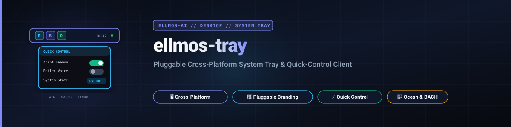

<p align="center">
  
</p>

# ellmos-tray

[](pyproject.toml)
[](pyproject.toml)
[](LICENSE)
[](tests/)
[](CHANGELOG.md)

**Language / Sprache:** **English** | [Deutsch](README_de.md) · **LLM / Agent:** [llms.txt](llms.txt) · [SKILL.md](SKILL.md)

**Pluggable System Tray and Desktop Control Client for ELLMOS, BACH, and OCEAN**

`ellmos-tray` provides a cross-platform (Windows, macOS, Linux) system tray application and quick-control interface for local AI environments. It extracts the proven, high-utility desktop tray capabilities of BACH OS into a clean, standalone, decoupled module.

---

## Key Features

1. **Pluggable Branding & Theming**
   - Built-in presets for **ELLMOS** (`"E"`), **BACH** (`"B"`), and **Open Ocean** (`"O"`).
   - Fully customizable application IDs, menu labels, notification titles, and lock files.
   - Dynamic RGBA status icons reflecting operational state (Safe Mode, Full/Write Mode, Active Processing, Disconnected).

2. **Decoupled Architecture & Process Ownership (v0.1.2)**
   - Clean separation between UI state observation and background task execution.
   - **Start/Attach Detection:** Automatically detects whether backend is already running (`ATTACHED`) or launched by tray (`SPAWNED`).
   - **Clear Process Ownership:** Graceful termination on shutdown only for managed child processes; pre-existing backends are left untouched.
   - Optional pluggable execution runners (`TaskExecutionDelegate`, `LegacyBachIdleRunner`) for full backward compatibility without hardcoded user paths.

3. **Resilience & Recovery (v0.1.2)**
   - **Auto-Reconnect:** State machine (`CONNECTED`, `DISCONNECTED`, `RECONNECTING`) with exponential backoff and connection restored notifications.
   - **Crash- & Sleep-Recovery:** Detects machine suspend/resume cycles, refreshes sockets and states without deadlocking or stalls.
   - **Device Acceptance Check:** Built-in environment verification probing loopback network sockets, service ports, and storage permissions.

4. **Performance & Caching (v0.1.2)**
   - **Icon & Thumbnail Cache:** `IconCache` and `ThumbnailCache` eliminate redundant PIL allocations, font disk loads, and repaints.
   - **Adaptive Polling:** Dynamic polling frequencies (active 2s during processing, normal 5s when idle, backed off up to 30s when reconnecting).

5. **Robust Single-Instance Guarantees**
   - Fail-closed single-instance enforcement via OS byte-range locks (`msvcrt` on Windows, `fcntl.flock` on POSIX).
   - Crash-resilient: Locks are held at the OS kernel file handle level and are immediately freed if a process terminates.

6. **Windows Store & MSIX Readiness (v0.1.2)**
   - Preflight validation tool `tools/store_readiness.py` verifying MSIX manifests, publisher/identity formatting, store assets, WACK criteria, and loopback documentation.

---

## Installation

```bash
pip install -e .
```

Dependencies: `pystray>=0.19.5`, `Pillow>=10.0.0` (see [THIRD_PARTY_LICENSES.md](THIRD_PARTY_LICENSES.md) for Level-1 SBOM and LGPLv3 runtime import notes).

---

## CLI Usage

Run with default ELLMOS branding:
```bash
ellmos-tray
```

Run with BACH OS branding and settings:
```bash
ellmos-tray --brand bach
```

Run with Open Ocean branding:
```bash
ellmos-tray --brand ocean
```

Device environment acceptance check:
```bash
ellmos-tray --check-device
```

Windows Store & MSIX readiness preflight check:
```bash
ellmos-tray --store-preflight
# or directly:
python tools/store_readiness.py --json
```

Diagnostic smoke test for PromptBoard integration:
```bash
ellmos-tray --smoke-promptboard
```

---

## Python API Usage

```python
from ellmos_tray import TrayApp, TrayBranding, check_device_acceptance

# 1. Using predefined brandings
app = TrayApp(branding=TrayBranding.ocean())

# 2. Run device environment check
report = check_device_acceptance(branding=app.branding)
print(f"Device acceptance passed: {report.passed}")

# 3. Run the system tray
app.run()
```

---

## Testing

```bash
pytest
ruff check .
python tools/store_readiness.py
```

---

## License & Governance

MIT License. Copyright (c) 2026 Lukas Geiger.

- **Third-Party Licenses & SBOM:** [THIRD_PARTY_LICENSES.md](THIRD_PARTY_LICENSES.md)
- **Contributing:** [CONTRIBUTING.md](CONTRIBUTING.md) · **Code of Conduct:** [CODE_OF_CONDUCT.md](CODE_OF_CONDUCT.md)
- **Security & Privacy:** [SECURITY.md](SECURITY.md) · [PRIVACY_POLICY.md](PRIVACY_POLICY.md)
- **Agent / LLM Entrypoints:** [SKILL.md](SKILL.md) · [llms.txt](llms.txt)

---

## Security & Preflight Claim Boundaries

- **Authenticated Control API Redirect, Header & Size Boundary (`#510`):** Authenticated Control API calls attach Bearer tokens strictly to `base_url`, reject `CR`/`LF`/`NUL` header characters (`CWE-113`), cap response payloads to `4 MiB` (`CWE-400`), disable HTTP redirect following (`_NoControlRedirect`), and reject cross-origin redirect targets fail-closed. Browser quick links enforce explicit `http`/`https` schemes (`is_safe_http_url`) before calling `webbrowser.open`.
- **Privacy, Store Preflight & LGPLv3 Boundary (`#511`):** Default connections use local loopback (`127.0.0.1`); remote hosts are only contacted when explicitly configured via `--host` / `--gui-url`. `tools/store_readiness.py` (`--store-preflight`) reports `claim_boundary: "source_and_metadata_preflight_only"` and enumerates external release gates (`msix_package_build`, `authenticode_certificate_signing`, `wack_binary_certification_run`, `partner_center_submission`). See [SECURITY.md](SECURITY.md) (`48h` ack / `5` business days triage / `30` calendar days remediation SLA) and [THIRD_PARTY_LICENSES.md](THIRD_PARTY_LICENSES.md).
